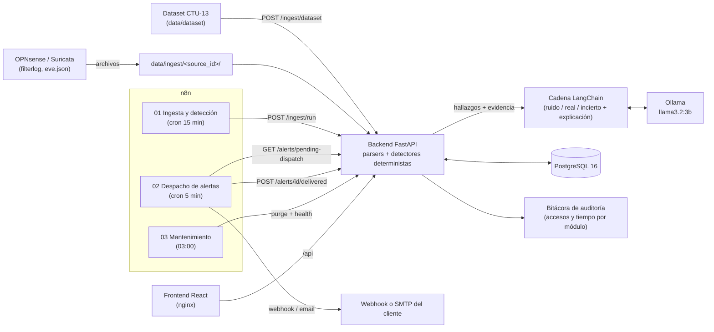

# NetSentinel

**Analista de logs de firewall/IDS para PYMEs** — Caso 26.

Un cron de n8n ingiere logs de OPNsense/Suricata; el backend detecta de forma **determinista** *beaconing*
(regularidad de intervalos) y puertos inusuales (además de exfiltración y alertas IDS); una cadena
**LangChain + Ollama** descarta el ruido y explica cada hallazgo en español; todo se guarda en PostgreSQL,
se despachan alertas y cada acceso a un módulo queda en la bitácora.

**Autores:** Roberto Enrique Quezada-Rodríguez y Melanie Celeste Tello Fuentes
— Universidad Nacional de Trujillo.

## Arquitectura



La detección autoritativa vive en el backend; el nodo Code de n8n (flujo 01, rama manual) solo ilustra el cálculo.

## Instalación de dependencias

El repositorio **no incluye dependencias instaladas** (`backend/.venv`, `frontend/node_modules`, `frontend/dist`, cachés) ni el dataset, las imágenes de Docker o el modelo de lenguaje. Todo se descarga a partir de los archivos de bloqueo `backend/uv.lock` y `frontend/package-lock.json`, que sí están versionados.

### Opción A — Docker (recomendada; no requiere instalar nada más)

Requisitos: Docker con Compose v2, `curl` y `make`. `make up` construye las imágenes e instala dentro de ellas todas las dependencias de Python y de Node; además descarga las imágenes base (PostgreSQL, n8n, Ollama, nginx) y el modelo `llama3.2:3b` (~2 GB). Siga el *Arranque en 4 pasos* de la sección siguiente.

Si Docker responde `permission denied` sobre `/var/run/docker.sock`, añada su usuario al grupo y vuelva a iniciar sesión:

```bash
sudo usermod -aG docker $USER
```

### Opción B — Entorno local de desarrollo (pruebas, lint y servidor de desarrollo)

Requisitos: Python 3.11 o superior, [uv](https://docs.astral.sh/uv/), Node.js 24 y npm.

```bash
# Backend: crea backend/.venv e instala las dependencias exactas de uv.lock (incluye pytest)
cd backend
uv sync

# Comprobación: ejecuta las pruebas automatizadas
uv run pytest -q
```

```bash
# Frontend: instala las dependencias exactas de package-lock.json en frontend/node_modules
cd frontend
npm ci

# Comprobación: compila la aplicación en frontend/dist
npm run build
```

Para desarrollar la interfaz sin backend use `npm run dev:mock`; con el backend en `localhost:8000`, `npm run dev`.

### Qué más se descarga y con qué comando

| Recurso | Tamaño aproximado | Cómo obtenerlo |
|---|---|---|
| Dependencias de Python (`backend/.venv`) | 680 MB | `cd backend && uv sync` |
| Dependencias de Node (`frontend/node_modules`) | 230 MB | `cd frontend && npm ci` |
| Imágenes de Docker y dependencias dentro de ellas | varios GB | `make up` |
| Modelo de lenguaje `llama3.2:3b` | 2 GB | automático en `make up` (servicio `ollama-init`) |
| Dataset de demostración CTU-13 | 14 MB | `make dataset` |

Para volver a dejar el proyecto sin dependencias instaladas:

```bash
rm -rf backend/.venv frontend/node_modules frontend/dist backend/.pytest_cache && find . -type d -name __pycache__ -prune -exec rm -rf {} +
```

## Arranque en 4 pasos

Requisitos: Docker con Compose v2, `curl` y `make`.

```bash
# 1. Genera .env con secretos aleatorios (no imprime los valores)
make init            # o: ./scripts/init-env.sh

# 2. Descarga el dataset real de demostración (~14 MB; pide confirmación)
make dataset         # o: ./scripts/fetch-dataset.sh [--yes]

# 3. Construye y levanta todo (la primera vez descarga imágenes y el modelo, ~2 GB)
make up

# 4. Carga el dataset en el backend (rebase de fechas a "ahora")
make load-dataset
```

Después abra la interfaz, entre con el usuario administrador y revise *Hallazgos* y *Panel*.

## URLs

| Servicio | URL |
|---|---|
| Interfaz web | http://localhost:5173 |
| API (docs interactivas) | http://localhost:8000/docs |
| n8n | http://localhost:5678 |
| Ollama | http://localhost:11434 |
| PostgreSQL | `localhost:5433` (usuario/base `netsentinel`) |

**Credenciales:** el usuario administrador (`ADMIN_USERNAME`, por defecto `admin`) y su contraseña
(`ADMIN_PASSWORD`) están en el archivo `.env` generado por `make init`. No se escriben en este documento.
La primera vez que abra n8n le pedirá crear su cuenta de propietario (es local a n8n).

## Módulos

Panel · Logs · Hallazgos · Alertas (y reglas) · Reportes (operacionales y de gestión, PDF/DOCX/XLSX) ·
Activos · Fuentes · Listas (permitidos/denegados) · Ingesta · Detección y LLM (configuración) ·
Usuarios y roles (RBAC) · **Bitácora** (eventos, sesiones por módulo y tiempo de uso).
El contrato completo de la API está en [`docs/API_CONTRACT.md`](docs/API_CONTRACT.md).

## Laboratorio de aprendizaje automático

Módulo adicional (sección «Laboratorio ML» del menú, y reportes ML en Reportes) para entrenar, evaluar, explicar y
usar un clasificador **Botnet vs Normal** sobre CTU-13 (escenario 11). Todo el ciclo corre en el mismo stack:
backend FastAPI (`app/ml/*`), un servicio `ml-worker` (misma imagen, comando `python -m app.ml.worker`), PostgreSQL
y el volumen `ml_data` montado en `/data/ml` (instantáneas de datos, modelos, figuras y registros de trabajo).

| Fase | Pantalla / ruta | Contenido |
|---|---|---|
| 1 Datos | `/ml/datos` | Registro desde una fuente ingerida o archivo etiquetado subido; metadatos con versiones inmutables; estadística descriptiva; **validador de grupos** que bloquea el entrenamiento si la agrupación es inviable |
| 2 Entrenamiento | `/ml/entrenamiento` | Partición 70/15/15 por grupos; Dummy, regresión logística, Random Forest, HistGB y XGBoost; **CV anidada 5×3** con `StratifiedGroupKFold`, Optuna (TPE + poda por mediana) solo en pliegues internos; modelo final con umbral y calibración en Validación y **una sola** evaluación en Prueba |
| 3 Evaluación | `/ml/evaluacion` | Métricas por pliegue con IC 95 % (t y bootstrap), matrices de confusión con control de umbral, ROC/PR con banda, calibración, Friedman, Wilcoxon+Holm, McNemar, bootstrap pareado por grupos, tamaños de efecto, comparación con la línea base y con los detectores deterministas; promoción del modelo activo |
| 4 Explicabilidad | `/ml/explicabilidad` | SHAP global/local, importancia por permutación como contraste, mapas de calor, PDP/ICE, oclusión, estabilidad entre pliegues (Kendall) |
| 5 Reportes | Reportes | `ml_dataset`, `ml_training`, `ml_evaluation`, `ml_explainability`, `ml_inference`, `ml_model_card` en PDF/DOCX/XLSX; figuras a 600 DPI en **todos** los reportes; cada figura exportable a PNG (600 DPI) y SVG |
| 6 Inferencia | `/ml/inferencia` | Predicción individual (flujo, ventana, hallazgo o valores manuales), probabilidad calibrada, conjunto/intervalo conforme (cobertura verificada en Prueba), aviso fuera de distribución, severidad configurable paso a paso, SHAP local y narrativa en español (LLM bajo demanda, con plantilla determinista si falla) |
| 7 Optuna | `/ml/optuna` | Estudios persistidos en PostgreSQL (esquema `optuna`), tabla de trials en vivo con cancelación, gráficos desde JSON del backend, «Usar estos hiperparámetros» → Entrenamiento |

**Trazabilidad e interpretabilidad.** Cada tabla y figura lleva título autosuficiente, nota (n, definiciones, unidades),
un «Qué significa» de 1-3 frases y, si aplica, «Precaución», generados de forma determinista a partir de los valores reales
(no hay textos fijos). Se guardan semillas, versiones de librerías, hash de la instantánea y la definición versionada de variables.

**Decisiones metodológicas clave**
- Los flujos *Background* se excluyen del entrenamiento y la evaluación (sin verdad conocida); sí pueden puntuarse en inferencia.
- Variables prohibidas: IP, identificadores, marca de tiempo absoluta y etiqueta. La definición de variables va versionada con cada modelo.
- **Agrupación.** CTU-13 escenario 11 tiene solo 3 hosts con tráfico Botnet: agrupar por host no permite 5 pliegues externos. El validador lo detecta, lo explica,
  recomienda una clave viable (par origen-destino o bloque temporal; en estos datos, bloque temporal de 10 s) y bloquea el entrenamiento si la configuración es inviable.
  El bloque temporal es una validación **menos exigente** que por host: generaliza peor a hosts nuevos. Para validar por host hacen falta más escenarios cargados.
- Solo se cargan modelos generados por el propio sistema en `/data/ml` (ruta y SHA-256 verificados); nunca se deserializan modelos subidos por usuarios.
- No se descarga ningún dataset de Internet: solo fuentes ya ingeridas o archivos subidos (límite `ML_MAX_UPLOAD_MB`, extensiones validadas).

**Adaptación de la plantilla original.** La plantilla de partida era una app Streamlit orientada a imágenes. Se adaptó al stack
existente y a datos tabulares de flujos de red: (1) Streamlit → páginas React + API FastAPI; (2) imágenes/aumentos de datos →
variables por flujo o por ventana host-tiempo (sin fuga); (3) separación por imagen/paciente → separación por **grupos**
(bloque temporal, par origen-destino o host); (4) entrenamiento en el proceso de la UI → tabla `ml_jobs` + servicio `ml-worker`;
(5) gráficos Plotly/HTML → JSON de figuras que dibuja React en pantalla y matplotlib a 600 DPI en reportes y exportación;
(6) Grad-CAM → SHAP, permutación, PDP/ICE y oclusión de variables; (7) estudios Optuna en SQLite → PostgreSQL (esquema `optuna`).

**Monitoreo en vivo: *polling* corto y no SSE.** La pantalla de entrenamiento consulta `GET /ml/training/jobs/{id}` cada 2-3 s.
Se eligió porque (a) retoma sola al recargar la página (el estado vive en la base de datos, no en una conexión), (b) atraviesa nginx y los
proxies sin configuración especial ni reconexiones, (c) cada consulta es barata (un registro) y (d) un trabajo de minutos no necesita
latencia de milisegundos. Los trabajos tienen límite de tiempo, se pueden cancelar y reintentar, y guardan registro de errores.

**Detección con ML (opcional).** Un único modelo activo, promovido de forma explícita desde Evaluación (auditado). El interruptor
«Usar el modelo ML en el pipeline» (Detección) está **apagado por defecto**; al encenderlo, los hallazgos nuevos reciben `evidence.ml` y el
LLM lo usa como contexto. Si el ML falla, el pipeline sigue funcionando igual.

Scripts por trabajo (los usa el worker; también sirven para depurar): `python -m app.ml.scripts.{train,evaluate,explain,optimize} --job-id N`.

## Flujos de n8n

Se importan **y activan** solos la primera vez (servicio `n8n-import`, sin pisar cambios posteriores):

| Flujo | Disparo | Qué hace |
|---|---|---|
| `01-ingesta-y-deteccion` | cada 15 min | `POST /ingest/run` → resumen (logs, hallazgos, ruido) → si hay hallazgos, lanza el flujo 02. Incluye una rama manual que ilustra beaconing (CV de intervalos) y puertos inusuales. |
| `02-despacho-de-alertas` | cada 5 min | `GET /alerts/pending-dispatch` → por canal (webhook / email) → `POST /alerts/{id}/delivered`. |
| `03-mantenimiento` | diario 03:00 | `POST /maintenance/purge` + `GET /health` y registro del resultado. |

- Los flujos leen `NETSENTINEL_API_URL` y `N8N_API_KEY` (variables de entorno del contenedor; `N8N_BLOCK_ENV_ACCESS_IN_NODE=false`).
- **Correo:** el nodo *Enviar correo* viene deshabilitado. Cree una credencial SMTP en n8n, habilite el nodo y ponga
  `NETSENTINEL_SMTP_ENABLED=true` en `.env`. Mientras tanto esas alertas quedan pendientes (no se marcan como entregadas).
- Para volver a importar los flujos desde `n8n/workflows/` (sobrescribe cambios hechos en n8n): `make n8n-reimport`.
- Versión de n8n fijada: `n8nio/n8n:2.47.4`.

Un flujo equivalente de la cadena de interpretación para LangFlow está en [`langflow/`](langflow/README.md).

## Conectar un OPNsense / Suricata real

1. En *Fuentes* cree una fuente (formato `opnsense_filterlog` o `suricata_eve`) y anote su `id`.
2. Haga llegar los archivos de log a `data/ingest/<source_id>/` (p. ej. `rsync`/`scp` programado desde el firewall, o el
   *syslog remoto* de OPNsense hacia un archivo, o `eve.json` de Suricata).
3. Cada 15 minutos n8n llama a `POST /ingest/run`, el backend lee los archivos nuevos y ejecuta la detección.
   También puede ejecutarla a mano desde *Ingesta* o subir un archivo.

## Requisitos de hardware

| Recurso | Mínimo | Recomendado |
|---|---|---|
| CPU | 4 núcleos | 8 núcleos o GPU |
| RAM | 8 GB | 16 GB |
| Disco | 10 GB libres | 20 GB+ (logs y modelos) |

El modelo `llama3.2:3b` pesa **~2 GB** y corre en CPU (lento, unos segundos por hallazgo). Para usar GPU NVIDIA
descomente el bloque `deploy` del servicio `ollama` en `docker-compose.yml` (requiere `nvidia-container-toolkit`).
Puede cambiar de modelo con `OLLAMA_MODEL` en `.env`.

## Comandos útiles

`make help` · `make logs` · `make down` · `make test` (validaciones y pruebas) · `make clean` (borra volúmenes; pide confirmación).

## Solución de problemas

- **`permission denied` al usar docker**: agregue su usuario al grupo `docker` o use `sudo`.
- **Puerto ocupado (5173, 5433, 5678, 8000, 11434)**: cambie el mapeo `host:contenedor` en `docker-compose.yml`.
- **El backend no arranca / `Ejecute make init`**: falta `.env`; corra `make init`.
- **Los hallazgos no traen explicación (veredicto vacío)**: el modelo aún se está descargando o Ollama no responde.
  Revise `docker compose logs ollama-init` y `GET /api/v1/health` (`"llm": false`). Los detectores funcionan sin LLM.
- **`make load-dataset` responde 404**: falta el archivo en `data/dataset/`; ejecute `make dataset`.
- **`make load-dataset` responde 401/403**: la `N8N_API_KEY` de `.env` no coincide con la del backend en ejecución;
  recree con `docker compose up -d --force-recreate backend n8n`.
- **Los flujos de n8n fallan con "access to env vars denied"**: revise `N8N_BLOCK_ENV_ACCESS_IN_NODE=false` en el servicio `n8n`.
- **n8n no muestra los flujos activos**: `docker compose logs n8n-import`; reimporte con `make n8n-reimport`.
- **Cambió `N8N_ENCRYPTION_KEY` y n8n no arranca**: restaure la clave original o borre el volumen `n8n_data`.

## Atribución del dataset

El dataset de demostración es **CTU-13, escenario 11** (CTU-Malware-Capture-Botnet-52, botnet Rbot con tráfico C&C real),
del *Stratosphere Laboratory, CTU University* (Praga). Uso libre citando el proyecto y sus autores:

- Garcia, Sebastian. *Malware Capture Facility Project*. https://stratosphereips.org
- Garcia, S., Grill, M., Stiborek, J., Zunino, A. *An empirical comparison of botnet detection methods*.
  Computers & Security 45 (2014) 100-123.
- Fuente: https://mcfp.felk.cvut.cz/publicDatasets/CTU-Malware-Capture-Botnet-52/ · https://www.stratosphereips.org/datasets-ctu13

El script guarda una copia de esta atribución en `data/dataset/ATTRIBUTION.txt`.
